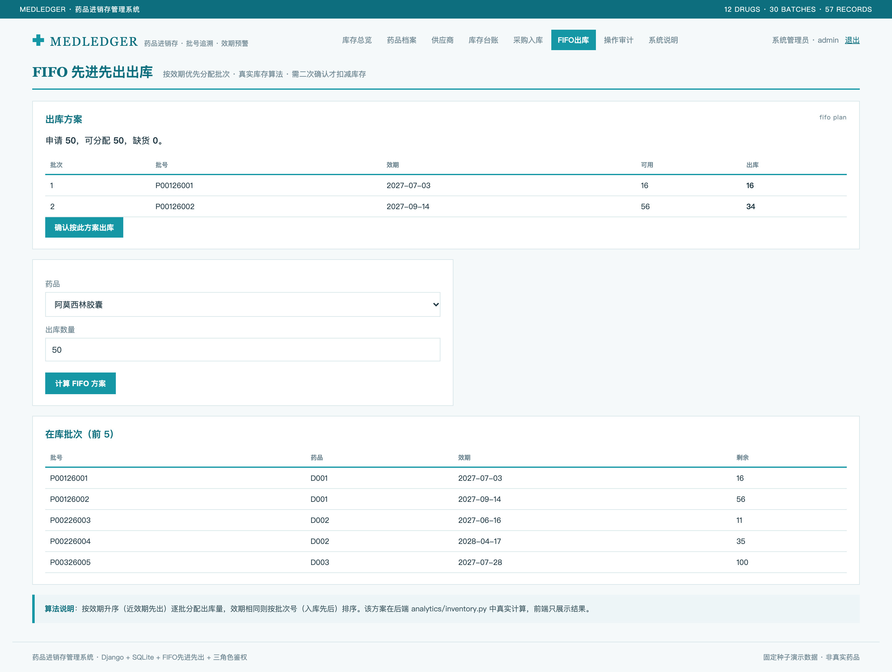
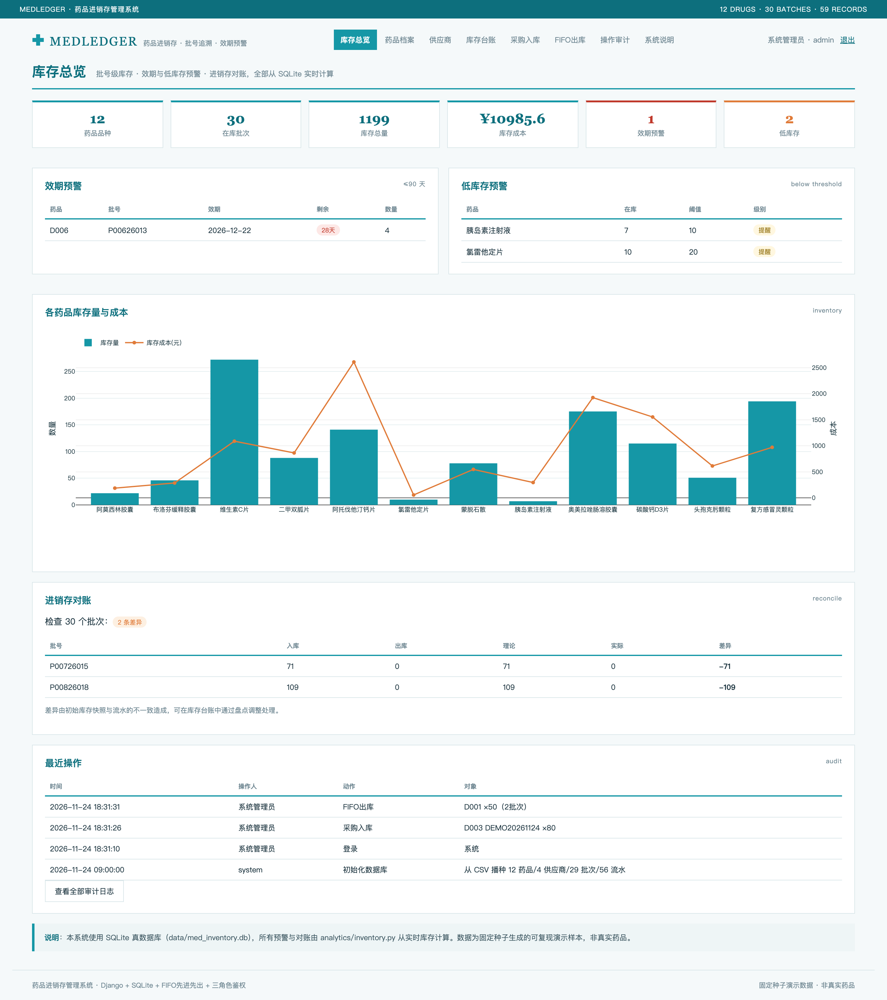
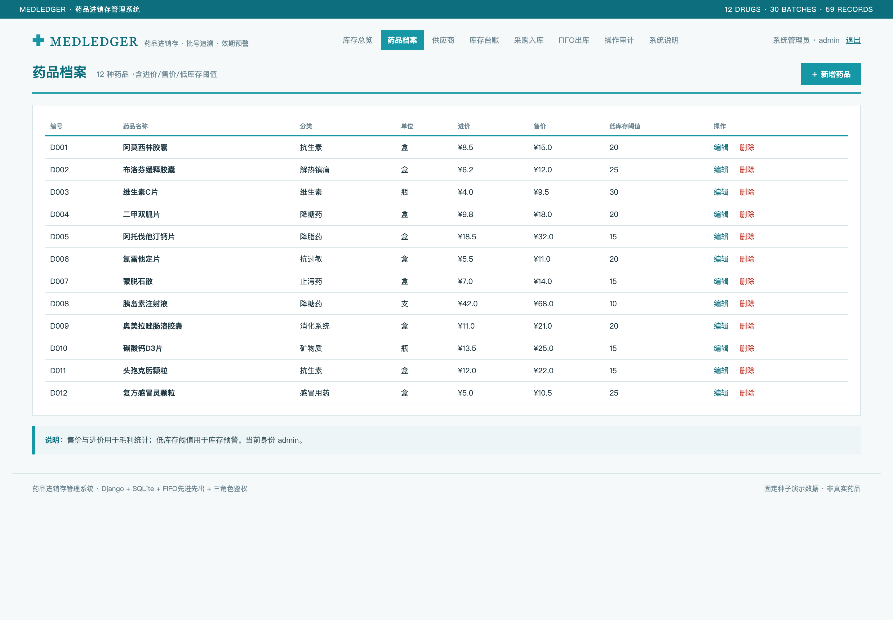
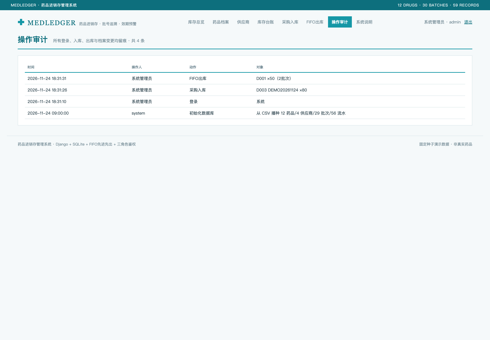
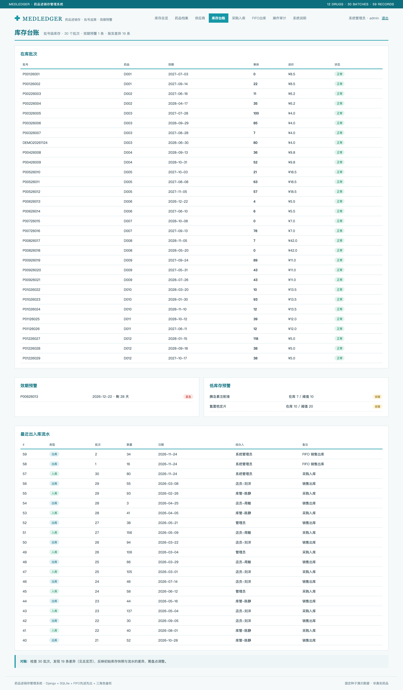
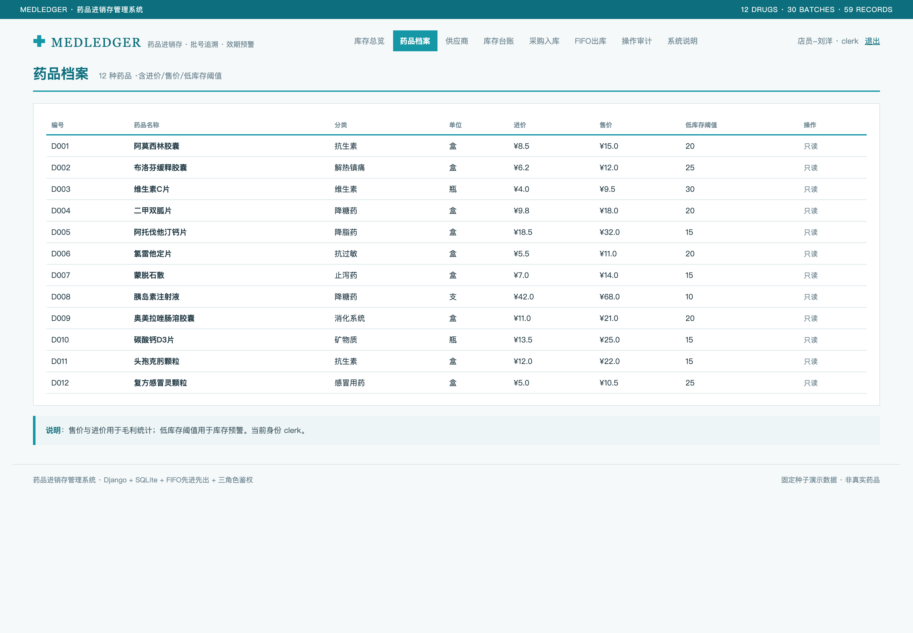

# 087 基于Django的药品进销存管理系统-设计展示

> **代码有偿获取 可接受定制 微信联系方式: csbysj2020 或 ACE2487，备注(BS)**

> **完整源码与全套文档 · 在线自助获取 >>> [https://mbd.pub/o/bread/YZaWmZdpaw==](https://mbd.pub/o/bread/YZaWmZdpaw==)**

> **成品页（功能介绍 / 更多选题）>>> [https://bishe.suilang.net/products/med-ledger](https://bishe.suilang.net/products/med-ledger)**

> 

> 

## 视频

> **点击查看 >>> [https://www.bilibili.com/video/BV1UEyfzgEpB/](https://www.bilibili.com/video/BV1UEyfzgEpB/)**

## 项目简介

医药冷链风格（青蓝主色、效期色标），区别于校园公文/学术实验室/看板。Django + SQLite 真数据库 + 三角色鉴权（管理员/库管/店员）+ 完整 CRUD。核心为按效期优先的 FIFO 先进先出出库算法，含效期与低库存预警、进销存对账、操作审计。演示数据 12 药品 / 29 批次 / 56 流水，库存 ¥11090.6，9 个页面。固定种子可复现，非真实药品。

药品零售与药房管理涉及采购入库、销售出库、库存盘点与效期预警等多类事务，同一药品的多批号与不同效期使先进先出难以人工保证。

本项目设计并实现一套药品进销存管理系统：以药品编号与批号为主键构建药品—供应商—批次—库存—出入库流水的关联模型，采用 Django + Jinja2 与医药冷链式界面（青蓝主色、效期色标），实现登录鉴权、药品与供应商档案维护、采购入库、按效期优先的 FIFO 出库、库存台账、效期与低库存预警、盘点对账与操作审计。

实验基于固定种子生成的可复现演示数据，覆盖 12 种药品、29 个批次与 56 条出入库流水，库存总量 1169、成本 ¥11090.6。

本仓库为**设计展示**：包含项目说明、技术架构、实验结果与运行截图；完整源码、任务书、开题报告、毕业论文与使用说明可通过上方链接自助获取，成品页可查看更多选题，也可联系微信咨询定制。

## 功能特性

1. 真系统：Django + SQLite 7 张表，业务数据实时读库，非只读展示页

2. 三角色鉴权：admin 全部 / keeper 库管 / clerk 店员只读（无编辑入口）

3. FIFO 先进先出：按效期升序逐批分配出库，效期相同按批号，二次确认才扣库存

4. 效期预警：≤90 天分级（紧急/警告/提醒）；低库存预警：低于档案阈值

5. 进销存对账：理论库存=入库−出库，与快照逐批比对列差异

6. 完整 CRUD：药品档案、供应商、采购入库、库存台账、操作审计

7. 操作留痕：登录/入库/FIFO出库/档案变更全部写入审计

8. 技术栈差异化：Django+Plotly.js+冷链视觉，区别于 Flask+D3 与 PyTorch+Plotly

## 技术架构

| 项目 | 说明 |
| --- | --- |
| 编程语言 | Python 3.8+ |
| Web 框架 | Django 4 + Jinja2 |
| 数据库 | SQLite 真数据库 med_inventory.db（7 表） |
| 核心算法 | analytics/inventory.py（FIFO/预警/对账） |
| 图表 | Plotly.js（本地化离线可用） |
| 样本规模 | 12 药品 / 29 批次 / 56 流水 |
| 运行端口 | http://127.0.0.1:8087 |
| 演示账号 | admin/admin123、keeper/keeper123、clerk/clerk123 |

## 目录结构

以下为完整交付版的结构（本仓库仅作设计展示）：

```
med-ledger/
├── analytics/
│   └── inventory.py
├── crawler/
├── data/
│   ├── analysis/
│   │   ├── expiry_alerts.json
│   │   ├── fifo_demo.json
│   │   ├── low_stock.json
│   │   ├── reconcile.json
│   │   └── summary.json
│   ├── processed/
│   │   ├── batches.csv
│   │   ├── drugs.csv
│   │   ├── inventory.csv
│   │   ├── stock_io.csv
│   │   └── suppliers.csv
│   ├── med_inventory.db
│   └── stats.json
├── medproj/
│   ├── __init__.py
│   ├── settings.py
│   ├── urls.py
│   └── wsgi.py
├── medweb/
│   ├── __init__.py
│   ├── db.py
│   └── views.py
├── static/
│   ├── css/
│   │   └── style.css
│   └── vendor/
│       └── plotly.min.js
├── templates/
│   ├── about.html
│   ├── audit.html
│   ├── base.html
│   ├── drug_form.html
│   ├── drugs.html
│   ├── login.html
│   ├── overview.html
│   ├── stock.html
│   ├── stock_in.html
│   └── …
└── …
```

## 数据与实验结论

- （说明：摘要统计为初始种子态 29 批次 / 56 流水 / 1169 单位；演示截图为执行 1 次采购入库 +80 与 1 次 FIFO 出库 −50 后的状态，故为 30 批次 / 59 流水 / 1199 单位，差值与药品档案进价完全吻合。）
- 真系统：Django + SQLite 7 张表，业务数据实时读库，非只读展示页
- 效期预警：≤90 天分级（紧急/警告/提醒）；低库存预警：低于档案阈值
- 技术栈差异化：Django+Plotly.js+冷链视觉，区别于 Flask+D3 与 PyTorch+Plotly

## 交付内容

1. 完整源码（Django 应用 + SQLite 数据层 + FIFO 算法 + 鉴权/CRUD + 9 页面）
2. 真数据库 med_inventory.db（7 表，从 CSV 播种）
3. 任务书与开题报告（Word）
4. 毕业论文（Word 七章制）
5. 二次开发说明（Word+md）
6. 10 张截图 + 封面 + 89s 视频

## 常见问题

**是真实库存扣减吗？**

是。FIFO 出库确认后事务性更新库存表并写入流水，刷新后仍保持。

**FIFO 怎么算？**

按效期升序逐批分配，效期相同按批号（入库先后）；申请50时近效期批出16、下一批出34。

**效期预警规则？**

≤90 天在库批次，≤30 天紧急、≤60 天警告、其余提醒。

**对账差异是什么？**

理论库存=入库−出库，与当前快照不一致即差异，系统如实列出。

**数据真实吗？**

固定种子 20231124 生成的可复现演示样本，非真实药品。

## 截图







